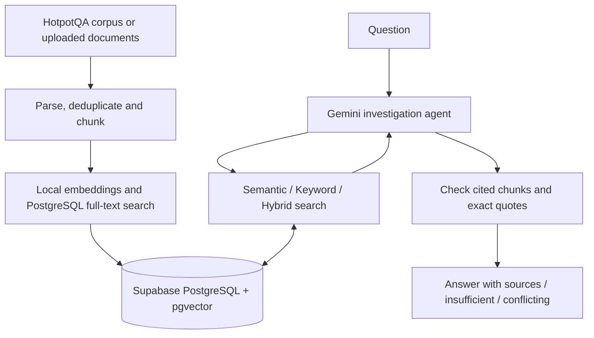

# EvidenceAI

EvidenceAI is an AI investigation engine for questions that need information
from more than one document. The goal is not to build another "chat with PDF"
app: the system has to find relevant sources, connect facts, and explain where
an answer came from.

It works with a **50,000-record HotpotQA corpus** and administrator-uploaded
documents. Gemini drives the investigation using search tools, and the final
answer includes quotes from the retrieved evidence. When the evidence is
missing or conflicting, the system can report that instead of making up an
answer.

**[Live demo](https://evidence-ai-frankfurt.onrender.com/)** ·
[Evaluation results](EVALUATION_REPORT.md) ·
[Architecture](docs/ARCHITECTURE.md)

## Try the demo

Open the [investigation page](https://evidence-ai-frankfurt.onrender.com/),
ask a question, and inspect the answer and its sources. You can choose between
**Semantic**, **Keyword**, and **Hybrid** retrieval. Semantic is the default,
based on the experiments described below.

The page includes example questions for different investigation scenarios.
The conflicting-evidence examples use synthetic evaluation fixtures that are
**not part of the live indexed corpus**; their results are in the
[evaluation report](EVALUATION_REPORT.md).

There is also a [document library](https://evidence-ai-frankfurt.onrender.com/library)
for uploading, inspecting, replacing, and deleting documents. These actions
require an administrator token. For evaluation, the token is provided in
the submission email. No token is stored in this repository.

The app uses **Render Free**, so the first visit after inactivity can take
about a minute to load. Investigations are rate-limited per IP (two requests
per minute in the Render configuration); if you hit the limit, wait a minute
before trying again. Each question is handled independently; it does not
remember previous questions as a conversation.

## How it works



1. **Prepare the documents.** The system accepts text-based **PDF, DOCX,
   TXT, and Markdown** files, extracts text and metadata, supports two
   chunking strategies, and deduplicates content while preserving its source
   information. Scanned PDFs need OCR beforehand. Uploaded documents are
   managed separately from the original corpus.

   I compared two chunking strategies: **Paragraph** keeps paragraph
   boundaries (splitting paragraphs over 1,000 characters for uploads);
   **Fixed Overlap** uses 1,000-character windows with 150 characters of
   overlap. On a 1,548-character fixture, Paragraph produced **4 chunks**
   (1,542 stored characters) and Fixed Overlap produced **2 chunks**
   (1,698 stored characters). Both covered **3/3 supporting sentences**
   and achieved **1.00 Recall@1 and MRR** on that small fixture.
   Paragraph is the default: it avoids duplicated overlap text, while fixed
   windows keep neighbouring context but may cut through sentences.
   This is a fixture comparison, not evidence of 50K-corpus retrieval
   performance. [Full comparison](reports/document_ingestion.md).

   Content hashes are based on normalized text. Identical corpus paragraphs
   are stored once while their source references are retained.

2. **Retrieve evidence.** FastEmbed creates 384-dimensional
   `BAAI/bge-small-en-v1.5` embeddings, stored in Supabase with pgvector.
   PostgreSQL full-text search provides the keyword results. Hybrid retrieval
   merges both ranked lists through an in-project **Weighted Reciprocal Rank
   Fusion (RRF)** implementation.

3. **Investigate.** Gemini uses structured search-tool calls to follow
   evidence across documents. An investigation allows up to four search steps
   and five Gemini HTTP attempts, including retries. Request and output limits
   keep the process bounded.

   Timeouts, network failures, and server errors can be retried with a short
   backoff within the remaining request and time budget. Repeated quota or
   provider failures end the investigation; the API returns a clear, sanitized
   error rather than a raw provider response.

4. **Validate the answer.** Before accepting a citation, the system checks
   that its chunk was retrieved during this investigation and that the exact
   quote is present in the source. A matching quote verifies **source
   presence**, not whether the model interpreted the relationship correctly.

The 50,000 HotpotQA paragraphs were indexed separately; the web app does not
rebuild the corpus on startup. The original indexed corpus is read-only during
investigations.

## Architecture decisions

| Choice | Reason |
| --- | --- |
| **FastAPI** | The interface and Python API can run as one service. |
| **Supabase PostgreSQL + pgvector** | Vector search, keyword search, source metadata, and persistent document storage stay in one database. |
| **FastEmbed + halfvec(384)** | Local embeddings avoid an additional embedding API cost; halfvec uses less storage. |
| **Weighted RRF** | Hybrid ranking is a clear, configurable component implemented in the project rather than outsourced entirely to a retrieval framework. |
| **Gemini with bounded tools** | The model can search in several steps without unlimited tool calls or API usage. |

I kept **Semantic** as the default because it performed better in the recorded
30-question retrieval comparison, both in supporting-source recall and
latency. Keyword and Hybrid are still implemented and selectable.

I chose HotpotQA because its multi-hop questions require connecting evidence
across documents, which fits this project better than single-document Q&A.
The reproducible 50K subset uses the pinned
[HotpotQA distractor train split](https://huggingface.co/datasets/hotpotqa/hotpot_qa)
with sampling seed `42`. The selection includes the supporting passages for
the selected development questions and answerable final cases. Synthetic
conflict fixtures were kept out of the production index.

The recorded ingestion reached **50,000 documents,
50,018 source records, and 50,000 chunks**; the database was **290.47 MiB**
after the final zero-insert check. Details are in
[corpus preparation](docs/HOTPOTQA_CORPUS_BUILD.md) and the
[50K capacity report](reports/capacity_50k.md).

## Evaluation

Development questions were kept separate from the **45-case final set**:
25 multi-hop, five single-hop, eight unanswerable, and seven synthetic
conflict cases. The 38 non-conflict cases used the live investigation path;
conflict cases used injected evidence with the agent and citation validator,
without testing database retrieval.

| Measurement | Result |
| --- | --- |
| Semantic retrieval Recall@10 | **0.8833** on 30 answerable final cases |
| Correct answer-span match | **19/30** answerable cases |
| Multi-hop answer match | **14/25** cases |
| Overall correct, including valid abstentions | **27/38** production-path cases |
| Correct abstention | **8/8** synthetic unanswerable cases |
| Conflict detection | **1/7** in the original run; **7/7** in a later post-fix rerun |
| Valid exact-quote citations | **38/45** draft citations passed |

The original 45-case run used **162 Gemini HTTP requests**. Semantic had the
strongest retrieval results in the comparison, but that does not mean all
answers were correct. For example, one multi-hop DHL question retrieved the
supporting sources but connected the wrong people in the final answer.

The seven-conflict rerun was a **post-hoc regression check**, not a new
independent evaluation. Its fix was selected using separate development
fixtures, not the final conflict cases.
Answer generation was evaluated with Semantic only; Keyword and Hybrid were
compared at the retrieval stage.

Next steps are to make the agent check the entity relationship at each hop
(the DHL failure), add an entailment check beyond exact-quote matching, and
measure answer quality with Hybrid as well as Semantic.

The
[Evaluation Report](EVALUATION_REPORT.md) contains the complete metrics,
methodology, failure cases, and latency results.

## API

| Route | Purpose |
| --- | --- |
| `POST /api/investigate` | Accepts `{question, retrieval_mode}`; returns status, answer, and cited claims. |
| `/api/documents` | Upload, list, inspect, replace, and delete documents (admin Bearer token). |
| `GET /` · `GET /library` | Investigation page and document library. |
| `GET /health` | Process liveness. |

## Run locally

Use **Python 3.11**.

**Windows (PowerShell):**

```powershell
python -m venv .venv
.\.venv\Scripts\Activate.ps1
Copy-Item .env.example .env
```

**macOS / Linux:**

```bash
python3 -m venv .venv
source .venv/bin/activate
cp .env.example .env
```

Install dependencies, download the embedding model into the project cache,
then start the app:

```bash
python -m pip install -r requirements-dev.txt
python scripts/download_model.py
python -m uvicorn app.main:app --reload
```

Edit `.env` before using live investigations:

- `DATABASE_URL` — connection string for the dedicated Frankfurt EvidenceAI
  Supabase project. The app refuses another project identity.
- `GEMINI_API_KEY` — Gemini API key, kept on the server.
- `ADMIN_TOKEN` — a random secret of at least 32 characters, needed for
  document management.
- `INVESTIGATION_DAILY_BUDGET` — set a positive budget after checking
  the available Gemini quota. The example value is `0`, which disables
  investigation requests.

Do not commit `.env` or expose credentials in the browser.

Open `http://127.0.0.1:8000/` for investigations and
`http://127.0.0.1:8000/library` for documents.
`GET /health` checks process liveness, not database or model connectivity.

### Reproduce the checks

```bash
python -m pytest -q
python -m scripts.compare_chunking
python -m scripts.evaluate_final
```

The full test suite runs offline without a `.env`, database connection, or
downloaded embedding model. The last command is an **offline evaluation-plan check**, not a fresh Gemini
evaluation. A read-only check of indexed evidence can be run with:

```bash
python -m scripts.evaluate_final --check-indexed-coverage
```

Live evaluation requires explicit API-usage confirmation and a configured
request budget; see [the methodology](reports/final_evaluation.md). To rebuild
the local corpus from the pinned dataset without writing to Supabase:

```bash
python -m scripts.build_corpus --seed 42 --write-large-files
```

## Deployment and limitations

The public app runs on **Render Free** in Frankfurt, backed by a persistent
Frankfurt Supabase database. The
[Render configuration](render.frankfurt.yaml) downloads the embedding model
during the build. Deployments are manual, and credentials are managed as
Render secrets.

Embeddings run locally, so **Gemini is the only metered model API** used by
the investigation pipeline. A question can make up to five Gemini requests;
the original 45-case evaluation used **162 requests**. The measured 50K
database size was about **290 MiB**, compared with Supabase Free's
**500 MB database-size allowance**. Free projects may pause after seven days
of low activity. Database size and actual disk usage are different limits; see
[Supabase pricing](https://supabase.com/pricing) and
[database-size details](https://supabase.com/docs/guides/platform/database-size).

Free-tier constraints affect the design: cold starts, a 512 MiB memory class,
and Gemini request quotas. The recorded model-startup peak was about
**287 MiB**, but repeated/concurrent investigation memory use has not been
fully verified. The request budget is process-local rather than a
restart-proof distributed quota: the per-IP, daily, and concurrent limits
are kept in each app process and reset after a restart. There is no OCR for
scanned PDFs and no multi-turn conversation memory.

For the implementation details, see
[Architecture](docs/ARCHITECTURE.md).
For measurement logs and experiment reports, see
[Reports](reports/README.md).

## Submission documents

- [Evaluation Report](EVALUATION_REPORT.md)
- [AI Usage Report](AI_USAGE_REPORT.md)
- [Assignment requirements coverage](reports/final_submission_checklist.md)
