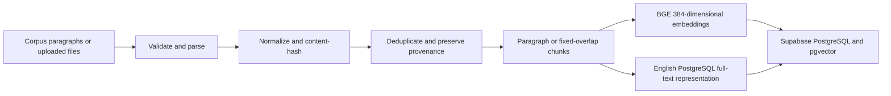
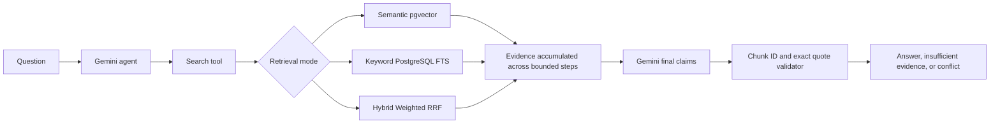

# EvidenceAI

EvidenceAI is a Python app for investigating questions across multiple
documents. It searches a 50,000-paragraph HotpotQA corpus using semantic and
keyword retrieval, then uses a bounded Gemini agent to connect evidence and
prepare answers with citations. Before returning a citation, it checks that
the quoted text appears in the retrieved source.

**Live demo:** [evidence-ai-frankfurt.onrender.com](https://evidence-ai-frankfurt.onrender.com/)

The demo URL and live examples were provided by the project owner. The current
Render deployment has not been independently rechecked.

## Project structure

| Folder | What's inside |
| --- | --- |
| [app/](app/) | The API, document processing, search, Gemini agent, citation checks, and web pages |
| [scripts/](scripts/) | Commands for building the corpus, running evaluations, and troubleshooting |
| [tests/](tests/) | Automated tests and sample upload files |
| [eval/](eval/) | Development questions and the final 45-question evaluation set |
| [migrations/](migrations/) | Database schema and migration proposals |
| [docs/](docs/) | Technical design, data preparation, and implementation notes |
| [reports/](reports/README.md) | Evaluation results, measurements, and earlier experiments |

Start with the [architecture overview](docs/ARCHITECTURE.md) if you want to
understand how the parts fit together. The [evaluation report](EVALUATION_REPORT.md)
covers what worked, what failed, and how the results were measured. AI assistance
is documented in the [AI usage report](AI_USAGE_REPORT.md).

## What it does

- Accepts text-based PDFs, DOCX, TXT, and Markdown files. Scanned PDFs need
  OCR beforehand; OCR is not built in.
- Stores document text and source details so each retrieved passage can be
  traced back to its document.
- Offers semantic, keyword, and hybrid search.
- Answers questions that may involve several sources, with quoted evidence
  attached to the claims.
- Returns insufficient evidence when it cannot support an answer, and can
  flag conflicting claims found by the agent.
- Restricts uploading, replacing, and deleting documents to administrators.

## Architecture

Document ingestion path:

Investigation path:

The agent allows at most four investigation steps and five Gemini HTTP
requests per investigation. A request cannot use more than five provider calls.
The public investigation endpoint defaults to Semantic retrieval.

## Technology choices

| Component | Choice | Reason |
| --- | --- | --- |
| API and pages | FastAPI, server-rendered HTML | One Python service serves JSON APIs and the interface. |
| Database | Supabase PostgreSQL, pgvector | Durable relational provenance, vector similarity, and PostgreSQL FTS in one store. |
| Embeddings | FastEmbed, BAAI/bge-small-en-v1.5 | Local query/document embeddings with 384 dimensions; no embedding API charge. |
| Vector representation | halfvec(384), cosine distance, HNSW | Reduced vector storage with the existing cosine retrieval path. |
| Keyword search | English PostgreSQL FTS, GIN | Stemming, stop-word handling, and title/body field weighting. |
| Hybrid ranking | Project-owned weighted Reciprocal Rank Fusion | Combines independently ranked result lists with deterministic tie-breaking and duplicate handling. |
| Answer generation | Configurable Gemini model; measured runs used gemini-3.5-flash-lite | Tool-capable generation bounded by request, time, and token limits. |
| Hosting | Render Free web service; Frankfurt Supabase project | Public demo on the selected free hosting tiers. |

### Retrieval modes and measured default

- **Semantic:** BGE question embedding followed by pgvector cosine search.
- **Keyword:** PostgreSQL English full-text search ranked with ts_rank_cd.
- **Hybrid:** both lists combined with the in-project weighted RRF
  implementation: each channel contributes weight / (k + rank), then stable
  IDs break ties.

Semantic is the default because it had the strongest measured retrieval
Recall@10/MRR and lower latency in the recorded evaluations. On the same 30
answerable final cases, Semantic had
Recall@10 0.8833, MRR 0.9167, and 836.5 ms median retrieval; Keyword had 0.4333,
0.3289, and 3,085.9 ms; equal-weight Hybrid had 0.8667, 0.8344, and 3,674.0 ms.
Hybrid and Keyword remain available for explicit requests, demonstrations, and
retrieval evaluation. These are retrieval metrics, not answer-accuracy scores.
See [EVALUATION_REPORT.md](EVALUATION_REPORT.md) and the
[retrieval tuning report](reports/retrieval_tuning_50k.md).

### Provenance and citation checks

Chunks refer to canonical text by character offsets, so returned evidence is
reconstructed from the original document. Each claim can cite retrieved chunk
IDs and exact supporting quotes. The validator verifies that the chunk was in
the retrieved evidence and that the quote appears verbatim after whitespace
normalization. It rejects unknown chunks and unverified quotes.

Quote matching proves evidence presence, not factual entailment. A valid quote
can still be misapplied to a claim or a relationship, as the DHL failure in the
evaluation report demonstrates.

## Corpus

The indexed corpus has 50,000 unique Wikipedia-paragraph records from the
HotpotQA distractor train split. The reproducible source revision is
1908d6afbbead072334abe2965f91bd2709910ab; sampling seed is 42. The generated
corpus file is local and Git-ignored. The Phase 5 record reports 50,000
documents, 50,018 provenance rows, 50,000 chunks, and a final database size of
304,576,179 bytes (290.47 MiB) after the zero-insert verification. Its measured
50,000-document projection with a 25% safety margin was 380,720,224 bytes.
These are historical measurements from the recorded run, not a fresh database
check. Details: [corpus audit](reports/corpus_audit.json) and
[capacity report](reports/capacity_50k.md).

### Measured design decisions

- Storing 384-dimensional embeddings as halfvec values used 38,800,000 bytes
  for the 50K corpus (excluding row and HNSW overhead) in the recorded database
  measurement.
- Chunk offsets preserve a single canonical document body and were verified
  against the corpus for Unicode-safe reconstruction.
- The recorded Render model-startup check peaked at 300,912,640 bytes RSS
  (287 MiB). That startup-only sample does not establish repeated or concurrent
  investigation memory safety; see [the Render preflight report](reports/render_preflight.md).

The separate datasets are:

- 200 retrieval-development questions in eval/retrieval_dev.jsonl.
- 45 final answer-evaluation cases in eval/final_answer_eval.jsonl.
- 40 source candidates retained for reproducible selection and evidence
  coverage, not as the completed final evaluation.

The 40 held-out candidates were not used to tune retrieval or prompts. Final
evaluation answers and retrieval-development questions remain separate.

## Demonstrated investigations

### Owner-reported two-source answer

The owner supplied a successful live response to “The company that oversees
Cyma Watches was founded when?” The answer was **1894**, linking the Cyma
Watches passage to a second passage about Universal Genève. The recorded
evidence uses two distinct chunk IDs and source titles. This is an owner-reported
production example, not an independently replayed request in this audit. See
[the interview demo record](docs/INTERVIEW_DEMO.md).

### Documented historical insufficient response

A production request for an updated managed TXT document returned
INSUFFICIENT with no claims or citations even though the replacement content
contained the answer. This was a **false abstention**, not a successful
insufficient-evidence decision. A bounded exact-title semantic rescue was
implemented and tested on development questions; the owner later reported that
the fix was deployed and the case answered with a verified citation. The
original response and diagnostic limits are documented in
[the replacement retrieval report](reports/replacement_semantic_retrieval.md).
Separately, the final evaluation correctly abstained on 8/8 synthetic
unanswerable cases; see the methodology and limits in the evaluation report.

## Local setup

Requirements: Python 3.11 and the native dependencies needed by FastEmbed.

1. Create and activate a virtual environment:
   <code>python -m venv .venv</code>
   <code>.\.venv\Scripts\Activate.ps1</code>
2. Copy .env.example to .env only if .env is missing:
   <code>if (!(Test-Path .env)) { Copy-Item .env.example .env }</code>
3. Install development requirements:
   <code>python -m pip install -r requirements-dev.txt</code>
4. Set
   GEMINI_API_KEY, the Frankfurt EvidenceAI DATABASE_URL, and a random
   server-side ADMIN_TOKEN with at least 32 characters. Never commit .env.
   INVESTIGATION_DAILY_BUDGET=0 disables live investigations; select a positive
   value only after checking the Gemini project's available quota.
5. Start the app:
   <code>python -m uvicorn app.main:app --reload</code>

Useful local checks:

- Full tests: <code>python -m pytest -q</code>
- Health endpoint: GET /health
- Investigation page: GET /
- Document library: GET /library
- Investigation API: POST /api/investigate
- Document management API: /api/documents (admin authentication required)

The running application rejects a DATABASE_URL whose project reference does not
match the configured Frankfurt EvidenceAI reference. Keep database and Gemini
credentials server-side.

## Reproduction

Offline evaluation-plan audit (does not call Gemini):

<code>python -m scripts.evaluate_final</code>

Read-only Frankfurt project and indexed support-coverage check:

<code>python -m scripts.evaluate_final --check-indexed-coverage</code>

The live evaluation CLI requires explicit operator quota approval and
confirmation; it uses local checkpoints and a request budget:

<code>python -m scripts.evaluate_final --live --final --comparison-plan economical --confirm-api-usage</code>

Rebuild the local HotpotQA corpus and retrieval-development file when needed:

<code>python -m scripts.build_corpus --seed 42 --write-large-files</code>

This command downloads the pinned public dataset and writes the large local
corpus/evaluation artifact files; it does not write to Supabase. The corpus and
caches are Git-ignored.

Chunk strategy fixture comparison:

<code>python -m scripts.compare_chunking</code>

Historical intermediate reports are preserved under
[reports/archive/](reports/archive/README.md); the detailed AI-assistance
chronology is preserved in [reports/AI_USAGE_REPORT.md](reports/AI_USAGE_REPORT.md).

## Deployment and free-tier limits

The intended Frankfurt Render Blueprint is
[render.frankfurt.yaml](render.frankfurt.yaml), with service name
evidence-ai-frankfurt, Frankfurt region, manual deploy, the model-cache build
step, and /health as a process-liveness check. The older [render.yaml](render.yaml)
is retained because the Dashboard's active Blueprint linkage was not accessible
to this audit. Do not replace, sync, rename, or redeploy either service without
checking the Render Dashboard and preserving its manual secrets and positive
investigation budget.

Render Free web services spin down after 15 minutes without inbound traffic and
take about a minute to start on the next request. Their filesystems are
ephemeral, and Free services may be restarted. The service configuration uses
Render Free's 512 MiB memory class. One recorded model-startup sample was
287 MiB; investigation peaks over repeated or concurrent requests remain
unverified. The first-visit notice cannot appear until the app has served its
initial HTML. See
[Render Free service limits](https://render.com/docs/free).

The GitHub scheduled keep-alive workflow was not added. /health reports only
that the application process is alive; it does not touch Supabase. A scheduled
ping cannot reliably keep a free Supabase project active, and GitHub schedules
can be delayed or disabled. No public database-touch endpoint was introduced.
For a live presentation, open the service shortly beforehand and allow the
documented cold start.

At this audit date, Supabase lists 500 MB of Free database size; Free projects
may pause after a week of inactivity, and the project disk allowance is a
separate 2 GB limit. Database size and physical
disk/WAL use must not be conflated. The recorded Phase 5 database size is below
the listed database-size quota, but its physical disk usage was not verified
from the Supabase Dashboard during ingestion. Plan limits can change; check
[Supabase pricing](https://supabase.com/pricing) and
[database-size documentation](https://supabase.com/docs/guides/platform/database-size)
before new bulk writes.

The application-wide investigation budget is process-local; it is not a
restart-proof global quota shared across Render instances. The Frankfurt
Blueprint leaves the value operator-managed. A per-process daily value of zero
disables investigations; configure a positive budget only after checking
Gemini project quota and reserving headroom for other callers.

## Known limitations

- The final answer evaluation is a small 45-case set; answer-span correctness is
  an automated proxy, not a human entailment judgment.
- The final answer-generation results cover Semantic only. Keyword and Hybrid
  were compared for retrieval, without extra Gemini answer generation.
- Multi-hop relation binding remains error-prone. The DHL case retrieved its
  support but chose Adrian Dalsey (whose own son was convicted) instead of
  Larry Hillblom (whose business partner's son was convicted).
- Conflict detection depends on model-produced conflict groups. The 7/7
  post-hoc fixture rerun is a small, non-independent check, not a general
  conflict-quality guarantee.
- Exact quote validation does not prove factual entailment.
- Render cold-start, current deployment commit, repeated/concurrent request
  memory behavior, and live upload verification for all formats are not
  independently confirmed by this packaging audit.
- The 50,000-record database measurement is historical; the application has no
  automatic 50K ingestion or schema migration at startup.

## Submission documents

- [Assignment compliance checklist](reports/final_submission_checklist.md)
- [Evaluation report](EVALUATION_REPORT.md)
- [AI usage report](AI_USAGE_REPORT.md)
